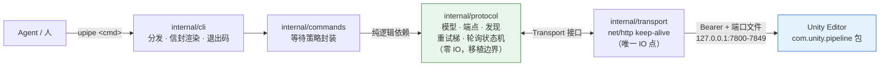

<div align="center">

# unity-pipe

**自维护的 Unity Pipeline 薄客户端 · Unity 2022 适配包分发 · AI Harness 插件包**

[](https://go.dev)
[-success)](go.mod)
[](cmd/upipe)
[-blue)](LICENSE)
[](LICENSE-NOTES.md)
[](https://github.com/Kayungko/unity-pipe/releases/tag/v0.1.0)

</div>

---

## 为什么是 unity-pipe

Unity 官方 `unity` CLI 是闭源单二进制，`pipeline install` 硬性要求 Unity 6+；社区适配仓库只解决了安装器问题，仍依赖官方分发渠道。而真正执行命令的，是编辑器内 `com.unity.pipeline` 包暴露的本地 HTTP API——CLI 只是个客户端。

**unity-pipe 把这条协议收归自维护**：Go 单二进制直连编辑器，零第三方依赖、零上游依赖；命令面运行时动态自发现，服务端包升级新命令**零改动可用**。

| | unity-pipe (`upipe`) | 官方 `unity` CLI |
|---|---|---|
| 外部依赖 | ✅ 零（纯 Go 标准库） | ⚠️ Unity 官方分发渠道 |
| Unity 2022 | ✅ 完整支持（自维护适配包） | ❌ `pipeline install` 要求 Unity 6+ |
| 命令面 | ✅ `GET /api/commands` 动态自发现 | ✅ 随版本发布 |
| Agent 友好 | ✅ 稳定退出码 + `--json` 单信封 | ⚠️ 人类可读输出为主 |
| 源码 | ✅ 全开源（本仓库） | ❌ 闭源 |
| 编辑器安装/认证 | ❌ 交给 Unity Hub（不冲突） | ✅ 内置 |

## 架构



分层单向依赖 `cli → commands → protocol ← transport` 由 [`layering_test.go`](layering_test.go)（go/parser import lint）**强制执行**；`protocol` 层零 IO，是未来 daemon 化 / 换语言移植的机械翻译边界。

域重载是协议核心难点：端口与 token 会被重写、连接会断——`upipe` 的重试梯**每轮重读端口文件**自动跟随，轮询状态机容忍断连抖动。

## 快速开始

```powershell
# 构建（或从 Release 下载 upipe.exe）
go build -o dist/upipe.exe ./cmd/upipe

# 探活（端口文件 + /api/status + editor_status；省略 --project-path 时从 cwd 向上自动发现）
upipe status --project-path E:\path\to\project

# 编辑器命令面（动态自发现）
upipe commands

# Agent 工作流核心循环
upipe exec set_autotick --set enable=true     # 后台工作前必开
#   ... 编辑 .cs 文件 ...
upipe recompile                               # 触发并轮询至 completed/up_to_date
upipe test --mode editor --filter MyFixture   # 异步执行 + 轮询，失败退出码 20
upipe eval "return 2 + 2;"                    # 快速求值
```

## 命令面

| 命令 | 说明 |
|---|---|
| `status` | 探活：端口文件实例 + 服务健康 + 编辑器状态 |
| `commands` / `commands --full` | 服务端命令索引 / 含参数 schema |
| `exec <name> [--set k=v] [--params JSON] [--job]` | 主通道，任意命令直通；`--set` 值自动做 JSON 标量类型推断 |
| `eval "<code>"` / `eval-file <path>` | C# 求值（`eval_file` 参数名映射为 `file`） |
| `recompile [--no-wait]` | 触发编译并轮询 `recompile_status` 至终态 |
| `test [--mode] [--filter] [--no-wait]` | `run_tests` 异步 + `test_status` 轮询 |
| `audit [--no-wait]` | Project Auditor 扫描 + 轮询 |
| `job <id>` / `job-cancel <id>` / `progress` | 分离式 job 模式与进度 |
| `pkg-status` / `pkg-install` | 适配包版本查询 / diff 计划安装（P4 只读目标拒绝） |
| `plugin install` | 安装 harness 技能到双 harness |

未封装的服务端命令一律走 `exec` 直通——这正是薄客户端契约：**子命令只封装等待策略，其余零改动跟进**。

## 退出码契约（agent 分支依据，不解析文本）

| 码 | 含义 | | 码 | 含义 |
|---|---|---|---|---|
| `0` | 成功 | | `20` | 命令失败（编译错误/测试失败，详情在 `error.data`） |
| `2` | 用法错误 | | `21` | 超时 |
| `10` | 未发现运行实例 | | `22` | job 已取消 |
| `11` | 域重载重试梯耗尽 | | `30` | 协议不兼容（包版本过旧/过新） |
| `12` | 认证失败（重启编辑器） | | `50` | 内部错误 |
| `13` | busy / settling / 队列满（可重试） | | | |

`--json` 时 stdout 恒为单一信封 `{"ok", "error":{code,kind,message,retryable,data}?, "data"}`；人类可读信息全走 stderr，stdout 永远可 `| jq`。

## 适配包（package/）

- **`0.5.0-2022.1`**：基于官方 `0.5.0-exp.1`（upstream revision `17df0ac8`），9 文件适配 Unity 2022.3（详见 [package/ADAPTATION-2022.md](package/ADAPTATION-2022.md)）
- 版本命名策略：semver 预发布段 `"2022.1" > "exp.1"`，UPM 视 vendored 版本更高，**不会被 registry 误"升级"覆盖**
- `upstream/` 原始基线（只读） · `com.unity.pipeline/` vendored 唯一真相源 · `patches/` 自动生成的适配补丁快照
- 构建：`go run ./package/build` → `dist/*.tgz` + SHA256（剔除 Tests/ 与失效签名）

```powershell
upipe pkg-status --project-path <project>                          # 已装版本 vs 仓库版本
upipe pkg-install --project-path <project> --source <tgz> --dry-run  # 预览 → 去掉 --dry-run 执行
```

## Harness 插件包（harness/）

三个技能（`unity-pipeline` / `unity-router` / `unity-mcp-bridge`）随仓库维护，一条命令安装到 AI Mana（`~/.claude/skills`）与 Codex（`~/.codex/skills`）双侧：

```powershell
upipe plugin install            # 仓库目录内执行；旧技能自动备份到 skills-backup/，逐文件 SHA256 校验
```

- AI Mana 当前会话即热加载；Codex 需新会话
- co-use 白名单机制、序列化资产红线、MCP 8080 契约均维持既有全局治理不变

## 目录

```
unity-pipe/
├── cmd/upipe/          入口（只做分发）
├── internal/
│   ├── cli/            参数分发 · 信封渲染 · 退出码
│   ├── commands/       子命令等待策略
│   ├── protocol/       纯逻辑协议层（零 IO，移植边界）
│   └── transport/      net/http（唯一 IO 点）
├── package/            适配包：upstream 基线 + vendored + 补丁 + 构建器
├── harness/            技能源 + install.ps1
├── docs/               PROTOCOL.md · MIGRATION.md
└── layering_test.go    分层依赖 lint（强制执行）
```

## 文档

- **[docs/PROTOCOL.md](docs/PROTOCOL.md)** — Pipeline HTTP 协议实测参考（端点、端口文件、域重载行为、job 模式、双重编码陷阱）
- **[docs/MIGRATION.md](docs/MIGRATION.md)** — 从 rocwood / 官方 CLI 迁移；后续编辑器管理能力迁移路线
- **[package/ADAPTATION-2022.md](package/ADAPTATION-2022.md)** — Unity 2022 适配全记录

## 开发

```powershell
go build ./...      # 构建
go vet ./...        # 静态检查
go test ./...       # 协议单元 + httptest mock 端到端 + 分层 lint
```

Go 工具链 ≥ 1.23；无 CGO、无第三方依赖、无生成代码。

## 许可 ⚠️

- **upipe 代码**（`cmd/` `internal/` `harness/` `docs/` `scripts/`）：[MIT](LICENSE)
- **`package/` 内的 com.unity.pipeline**：版权归 Unity Technologies，**不适用 MIT**

> 🔴 **本仓库必须保持 PRIVATE**——含 Unity 包再分发内容，禁止转为 public；`dist/*.tgz` 仅经私有 Release 分发。公开分发 upipe 时需剥离 `package/`。详见 [LICENSE-NOTES.md](LICENSE-NOTES.md)。
