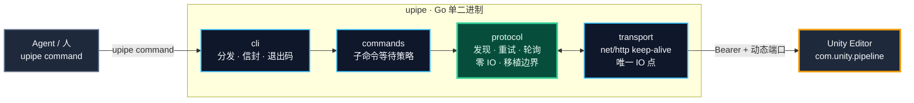

# 架构设计

> 本文面向会看源码、要接协议或维护本仓库的人。普通使用请看 [README](../README.md) 的快速开始。

## 为什么是 unity-pipe

Unity 官方 `unity` CLI 是闭源单二进制，`pipeline install` 硬性要求 Unity 6+；社区适配仓库只解决了安装器问题，仍依赖官方分发渠道。而真正执行命令的，是编辑器内 `com.unity.pipeline` 包暴露的本地 HTTP API——CLI 只是个客户端。

**unity-pipe 把这条协议收归自维护**：Go 单二进制直连编辑器，零第三方依赖、零上游依赖；命令面运行时动态自发现，服务端包升级新命令**零改动可用**。

| | unity-pipe (`upipe`) | 官方 `unity` CLI |
|---|---|---|
| 外部依赖 | ✅ 零（纯 Go 标准库） | ⚠️ Unity 官方分发渠道 |
| Unity 2022 | ✅ 完整支持（自维护适配包） | ❌ `pipeline install` 要求 Unity 6+ |
| 命令面 | ✅ `GET /api/commands` 动态自发现 | ✅ 随版本发布 |
| Agent 友好 | ✅ 稳定退出码 + `--json` 单信封 | ⚠️ 人类可读输出为主 |
| 源码 | ✅ 全开源（本仓库） | ❌ 闭源 |
| 编辑器安装/认证 | ❌ 交给 Unity Hub（不冲突） | ✅ 内置 |

## 客户端分层

分层单向依赖 `cli → commands → protocol ← transport` 由 [`layering_test.go`](../layering_test.go)（go/parser import lint）**强制执行**；`protocol` 层零 IO，是未来 daemon 化 / 换语言移植的机械翻译边界。

## 域重载跟随

域重载是协议核心难点：端口与 token 会被重写、连接会断——`upipe` 的重试梯**每轮重读端口文件**自动跟随，轮询状态机容忍断连抖动。协议细节（端点、端口文件、双重编码陷阱）见 [PROTOCOL.md](PROTOCOL.md)。

## 退出码契约（agent 分支依据，不解析文本）

| 码 | 含义 | | 码 | 含义 |
|---|---|---|---|---|
| `0` | 成功 | | `20` | 命令失败（编译错误/测试失败，详情在 `error.data`） |
| `2` | 用法错误 | | `21` | 超时 |
| `10` | 未发现运行实例 | | `22` | job 已取消 |
| `11` | 域重载重试梯耗尽 | | `30` | 协议不兼容（包版本过旧/过新） |
| `12` | 认证失败（重启编辑器） | | `50` | 内部错误 |
| `13` | busy / settling / 队列满（可重试） | | | |

`--json` 时 stdout 恒为单一信封 `{"ok", "error":{code,kind,message,retryable,data}?, "data"}`；人类可读信息全走 stderr，stdout 永远可 `| jq`。

未封装的服务端命令一律走 `exec` 直通——这正是薄客户端契约：**子命令只封装等待策略，其余零改动跟进**。

## 相关文档

- [PROTOCOL.md](PROTOCOL.md) — Pipeline HTTP 协议实测参考（端点、端口文件、域重载行为、job 模式、双重编码陷阱）
- [MIGRATION.md](MIGRATION.md) — 从 rocwood / 官方 CLI 迁移；后续编辑器管理能力迁移路线
- [../package/ADAPTATION-2022.md](../package/ADAPTATION-2022.md) — Unity 2022 适配全记录（双层补丁：兼容层 + 演进层）
- [CHANGELOG](../CHANGELOG.md) — 版本更新日志
